<picture>
  <source media="(prefers-color-scheme: dark)" srcset="dark_mode.svg">
  <source media="(prefers-color-scheme: light)" srcset="light_mode.svg">
  
</picture>

  
  
  
  

## Recent Projects

<table>
  <tr>
    <td></td>
    <td></td>
  </tr>
  <tr>
    <td></td>
    <td></td>
  </tr>
</table>

## Competitive Programming

| Platform | Solved | Profile | Rating |
|:--------:|:------:|:-------:|:------:|
| **Codeforces** | **195** | [Badhon_Pain](https://codeforces.com/profile/Badhon_Pain) | `837 (max 896)` |
| **HackerRank** | **50+** | [Badhon Pain](https://www.hackerrank.com/profile/badhonpain48) | `-` |
| **CodeChef** | **19** | [bimrissho_23](https://www.codechef.com/users/bimrissho_23) | `-` |
| **AtCoder** | **5** | [Badhon_Pain](https://atcoder.jp/users/Badhon_Pain) | `-` |
| **LeetCode** | **54** | - | `-` |

## Tech Stack

  
  
  
  
  
  
  
  

